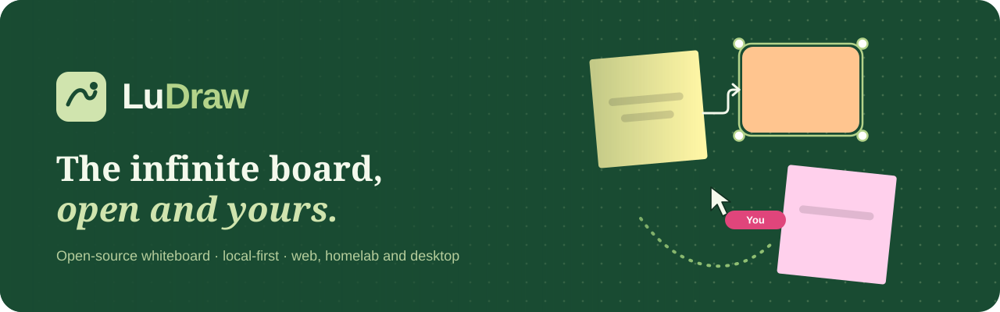
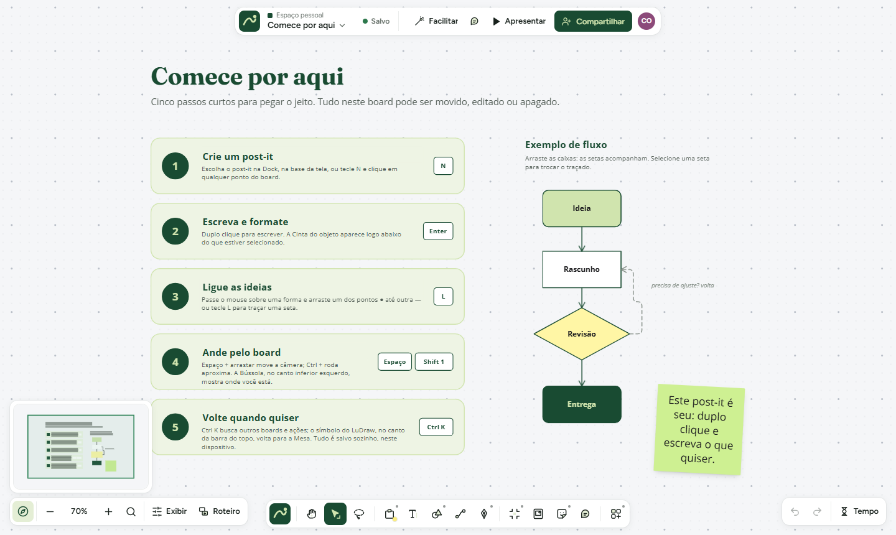
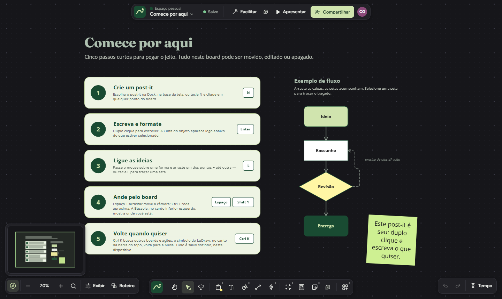

<div align="center">



<br />
<br />

**An infinite whiteboard to think, draw and plan, alone or with a team.**<br />
It runs right in the browser, keeps your data with you, and can be hosted on your own server.

<br />

[Português (Brasil)](README.md) · **English**

<br />


[About](#-about-the-project) · [What it does](#-what-ludraw-does) · [Limits](#-what-it-does-not-do-or-does-with-caveats) · [How to get started](#-how-to-get-started) · [Contributing](#-contributing)

</div>

---

## 🌱 About the project

LuDraw is a project by **Luka Piancó** ([LUKA.DEV](https://github.com/lukapianco)) and started as a **study project**: I wanted to learn how to build a complete program, from the canvas to real-time collaboration, with all the features a person needs to use it day to day. Along the way I learned a lot of new things (canvas rendering, simultaneous editing, permissions, security, accessibility, internationalization) and found faster ways to work.

It does not try to be anything beyond what it delivers: a beautiful, usable infinite whiteboard that you can open right now or install for your team.

> **About maintenance:** since this is a study project, I do not promise continuous updates. If anyone wants to **use** it, **suggest** things or **build new features**, I would be very happy: see [Contributing](#-contributing).

---

## 🖼️ See what it looks like

<div align="center">



<sub>Light theme: the welcome board, with the top bar, the tool Dock and the minimap. (The interface is shown in Portuguese; it also comes in English.)</sub>

<br />
<br />



<sub>Dark theme: the same board.</sub>

</div>

---

## ✨ What LuDraw does

There are more than **140 documented features** in [`docs/FEATURES.md`](docs/FEATURES.md), each with where to find it and its shortcut. In short:

<table>
<tr>
<td width="50%" valign="top">

### 🧭 Infinite canvas
- Pan with **Space + drag**, middle button or the Hand tool
- Smooth **zoom** centered on the cursor (2% to 400%)
- **Dot or line** grid, background color, **minimap**
- Selection by rectangle, lasso and Shift + click
- **Smart guides** and snap to grid

### ✍️ Objects
- **Sticky notes** with automatic font fitting
- **11 shapes** (rectangle, oval, diamond, star, cloud, cylinder…)
- **Text** with 20 fonts, lists, links and highlighter
- **Pen, highlighter and eraser**
- Images and **frames**

</td>
<td width="50%" valign="top">

### 🔗 Connectors
- Connection points with preview; one click creates an already-linked object
- **Straight, elbow or curved** lines, five arrowhead types
- Editable path or **automatic routing** that avoids objects
- Labels, insert a shape in the middle of a line

### 🛠️ Editing
- Multi-selection, resize and rotation handles
- **Undo/redo**, version history
- Group, layers, align and distribute
- Copy and paste style, duplicate with **Alt + drag**, lock

</td>
</tr>
<tr>
<td valign="top">

### 🧩 Team work tools
- **Kanban**, **tables** (with merged cells), **mind map**
- **Diagram from text**: write it and the diagram appears
- **Presentation mode** from frames
- **Dot voting**, **timer**, comments and reactions
- **Template gallery** and your own templates

### 👥 Collaboration (with a server)
- **Live editing** with several people, cursors and presence
- Follow someone's screen
- Board permissions: owner, editor, commenter and viewer, plus guests and public links

</td>
<td valign="top">

### 📤 Export and 📥 import
- **PNG** (1x, 2x and 4x), **vector SVG**, **PDF** single page or **multi-page by frames**
- **CSV** and **copy as spreadsheet**, protected against formula injection
- Import **spreadsheets** (`.xlsx`, `.ods`, `.csv`, `.tsv`), **editable SVG**, `.excalidraw` files, images and text, by pasting, dragging or from the menu
- **`.ludraw` backup** and restore
- **`<iframe>`** code to embed a board

</td>
<td valign="top">

### 🗂️ Workspace and administration
- Home with recents, favorites, search, spaces, teams and folders
- **Accounts and company login** (generic OIDC), invites by link or e-mail
- Administration: members, teams, policies, guests, **trash**, backup and **Audit Log**
- **Extensions** with explicit permissions, run isolated from the rest of the app

</td>
</tr>
</table>

**Also:** light and dark themes, **accessibility** (visible focus, contrast checked by tests and keyboard navigation), **Brazilian Portuguese and English**, and a documented **Design System**.

---

## 🧭 Three ways to use it

| | **Browser** | **Desktop app** | **Server with Docker** |
|---|---|---|---|
| For whom | Trying it out or personal use | Personal use without a browser, or as a client for your team's server | Teams and organizations |
| Where data lives | In the browser, on this device | In the app's folder, on this computer | In your server's PostgreSQL |
| Account | Not needed | Not needed (Local Mode) | E-mail and password or company login |
| Live collaboration | No | Only when connected to a server | Yes |
| Backup | Manual (`.ludraw` file) | Manual (`.ludraw` file) | Database + images folder |

**Local Mode** means using it without a server (browser or desktop); **Server Mode** is when a LuDraw server is involved. In the browser, the app detects by itself whether a server exists on the same origin and picks the mode; on desktop, you choose the first time you open it.

---

## 🚀 How to get started

There is no official hosted site: you run LuDraw on your own computer or server. Pick one of the three paths.

### 1️⃣ In the browser (Local Mode, no account)

**You need:** [Node.js](https://nodejs.org) 22.6+ (version in `.nvmrc`) and [Git](https://git-scm.com).

```bash
git clone https://github.com/lukapianco/ludraw.git
cd ludraw
npm install
npm run dev
```

Open **http://localhost:5173**, click **“Continue without an account”** and explore the welcome board. For a lighter version that does not reload on its own: `npm run build`, then `npm run preview`.

Boards live in the browser storage. To keep a copy, use **Board card → Export → Back up board** (a `.ludraw` file).

### 2️⃣ Desktop app (Windows and Linux)

The first time you open it, the app asks where you want to work: **on this computer** (Local Mode) or on **your organization's server**. The choice is remembered and can be changed in **LuDraw → Change where you work…**

#### Option A: download the installer

Installers will be published in the GitHub *Releases* from the first released version on, together with a **`SHA256SUMS`** file.

| | Windows 10/11 (64-bit) | Linux (Debian 12+, Ubuntu 22.04+) |
|---|---|---|
| File | `LuDraw_<version>_x64-setup.exe` | `ludraw_<version>_amd64.deb` |
| Install | Open the installer (current user only, no administrator) | `sudo apt install ./ludraw_<version>_amd64.deb` |
| Local Mode boards | `%LOCALAPPDATA%\app.ludraw` | `~/.local/share/app.ludraw` |
| Uninstall | Settings → Apps → LuDraw | `sudo apt remove ludraw` |

Uninstalling **does not delete your boards**. On Windows the uninstaller only deletes them if you tick that option; on Linux the folder stays.

**Check the file before installing** and compare the result with its line in `SHA256SUMS`:

```bash
# Linux (in the folder where you downloaded the files)
sha256sum -c SHA256SUMS --ignore-missing
```

```powershell
# Windows (PowerShell)
Get-FileHash .\LuDraw_<version>_x64-setup.exe -Algorithm SHA256
```

> ⚠️ **The Windows installer is not digitally signed.** Windows may warn that the publisher is unknown (SmartScreen) and, on computers with **Smart App Control** on, it may block the installer. If the SHA-256 does not match, **do not install**. Do not turn off any Windows protection to install LuDraw: if it is blocked, use LuDraw in the browser or through your organization's server.

#### Option B: build it yourself

Use this while there is no published version, or if you prefer to build the installer from the code.

**You need:**
- Node.js 22.6+ and Git.
- **Rust**, through [rustup](https://rustup.rs). The exact version is in `src-tauri/rust-toolchain.toml` and rustup installs it by itself.
- **Windows:** the *Visual Studio Build Tools* with the **“Desktop development with C++”** workload. WebView2 ships with Windows 11; on Windows 10 the installer downloads it if missing.
- **Linux:** `sudo apt install build-essential libwebkit2gtk-4.1-dev`. If the build complains about another library, the `cargo` message says which one.

```bash
git clone https://github.com/lukapianco/ludraw.git
cd ludraw
npm install
npm run desktop:dev        # builds and opens the app (the first run takes a while)
npm run desktop:package    # builds the installer for your system
```

The installer ends up in `src-tauri/target/release/bundle/`: an `.exe` (NSIS) in `nsis/` on Windows, or a `.deb` in `deb/` on Linux. Install it as in the table above.

> 💡 `desktop:dev` uses the app's **real profile** (the same boards folder as in the table). Boards you create there are saved.

**Desktop app limits:**
- Desktop boards and browser boards are **separate**; to move between them, use the `.ludraw` backup.
- In Server Mode, the server must be up for the app to open (the app is served by it).
- A server with a self-signed certificate requires the certificate to be trusted by the system.
- Company login (SSO) works when the provider redirects straight to its own address; federation to another domain does not work through the desktop app.

### 3️⃣ Server with Docker (teams, homelab)

For shared boards, accounts, invitations and live collaboration. It starts LuDraw and a PostgreSQL on the same origin.

**You need:** Docker Engine 24+ with Compose v2.24+ (or Docker Desktop on Windows/macOS) and Node.js 22+ on the machine, only for the secrets and backup scripts. For network use, a reverse proxy with HTTPS (Caddy, Traefik, nginx…).

> The image is **not yet published** to a registry (that is in preparation). For now Compose **builds it from the source**, which takes a few minutes the first time.

```bash
git clone https://github.com/lukapianco/ludraw.git
cd ludraw
node scripts/docker-secrets.mjs                     # 1) random secrets in deploy/secrets/ (once)
cp deploy/ludraw.env.example deploy/ludraw.env      # 2) optional: public URL, e-mail, SSO…
docker compose up -d --build                        # 3) builds the image and starts db → migration → app
docker compose logs app                             # 4) copy the first-access token
```

Open **http://localhost:8080**. The **Server first access** wizard asks for the token (it shows **once** in the log), the organization name and the first administrator account. To generate another token: `docker compose exec app ludraw setup:token`.

**After installing:**
- **Over the network:** put an HTTPS proxy in front and set `LUDRAW_PUBLIC_URL` and `LUDRAW_TRUST_PROXY` in `deploy/ludraw.env`. Caddy and nginx examples in [docs/DOCKER.md](docs/DOCKER.md) (Portuguese).
- **Backup:** `node scripts/docker-backup.mjs backup` saves the database and the images ([docs/BACKUP.md](docs/BACKUP.md)).
- **From the desktop app:** in the app, choose **server** and enter its address.
- **More options** (e-mail, company login, several instances with Valkey): [docs/DOCKER.md](docs/DOCKER.md) and [docs/SERVIDOR.md](docs/SERVIDOR.md), both in Portuguese.

---

## 🧱 What it does not do (or does with caveats)

So you can decide clearly whether LuDraw fits what you need:

- **It is not a hosted service.** There is no official site to create an account: you open it locally or host your own.
- **Local Mode does not sync.** Boards stay in the browser where they were created; to move them, use the `.ludraw` backup.
- **One organization per installation.** A mode with several organizations on the same server is not available yet.
- **Real time on a single server instance.** Running several server copies side by side is not yet supported for live editing.
- **No mobile app.** The interface is designed for computers and modern browsers. There is a desktop app for Windows and Linux (see above).
- **Extensions tested on Chrome and Edge.** Extension isolation still needs to be verified on Firefox and Safari.
- **Some items show as "Coming soon"** (for example schedule, video recording and clickable prototype) and do not work yet. Notifications do not exist yet either.
- **Languages:** Brazilian Portuguese and English. More languages are added with a JSON file (see [docs/TRANSLATING.md](docs/TRANSLATING.md)).
- **It is not an illustration, CAD or video editor.** It is a board for ideas, flows and planning.
- **Study project, version `0.x`:** there may be rough edges, and there is no guarantee of continued support.

---

## 🛠️ For development

Step-by-step instructions to run it are in [How to get started](#-how-to-get-started). These are the everyday commands:

| Command | What it does |
|---|---|
| `npm run dev` | Development server with hot reload |
| `npm run build` | Production build in `dist/` |
| `npm run preview` | Serves the build locally |
| `npm run typecheck` | Type checking (TypeScript strict) |
| `npm run server:dev` | Server Mode API in development (port 3001) |
| `npm run test:server` | Server tests, no Docker needed |
| `npm run desktop:dev` | Builds and opens the desktop app |
| `npm run test:desktop` | Desktop app tests (configuration, permissions and CSP) |

The full list of test and check commands is in **[CONTRIBUTING.md](CONTRIBUTING.md)**.

> 💡 **Where is my data?** In the browser or on desktop (Local Mode), in the app's own storage. Use **Board card → Export → Back up board** to save a `.ludraw` file. In Server Mode, in the server's PostgreSQL.

## ⌨️ Main shortcuts

| Action | Shortcut | | Action | Shortcut |
|---|---|---|---|---|
| Select / Hand | `V` / `H` | | Undo / Redo | `Ctrl Z` / `Ctrl Y` |
| Sticky note / Text | `N` / `T` | | Duplicate | `Ctrl D` |
| Rectangle / Oval | `R` / `O` | | Group | `Ctrl G` |
| Arrow line | `L` | | Find | `Ctrl F` |
| Pen / Eraser | `P` / `E` | | Fit to screen | `Shift 1` |

Inside a board, press `?` to see the full list.

---

## 🔐 Security and privacy

- Passwords with **argon2id**; tokens and links stored only as hashes.
- Permissions enforced **on the server**, with the same rules as the app.
- The project went through **internal audits** of code origin, accessibility and security, with findings and fixes recorded. **There was no independent external audit.**
- The Audit Log keeps the IP of sensitive actions for a configurable period (default 90 days) and then erases it.
- To report a security issue, see **[SECURITY.md](SECURITY.md)**.

---

## 🌍 Languages

The interface comes in **Brazilian Portuguese** and **English**. By default it follows the browser; in **Settings → Profile → Language and region** you can pick another one, without reloading. The content of your boards is never translated.

- Available languages and completeness: **[docs/LANGUAGES.md](docs/LANGUAGES.md)**
- How to add a new language with just JSON: **[docs/TRANSLATING.md](docs/TRANSLATING.md)**

---

## 🧱 How it is built

- **App:** React 18, TypeScript (strict), Vite, Tailwind and Zustand.
- **Server:** Node.js, Fastify, Drizzle and PostgreSQL.
- **Real time:** Yjs and Hocuspocus.
- **Principles:** all geometry goes through `screenToWorld`/`worldToScreen`; one geometry draws both the screen and the export; no hard-coded text in the interface (everything through `t()`); permission and workspace rules are the same in the app and on the server.
- **Look:** forest green `#194B32` and pistachio `#D0E4AE`, Figtree + Fraunces typography. Documentation in [`docs/DESIGN_SYSTEM.md`](docs/DESIGN_SYSTEM.md).

Main folders: `src/` (app), `server/` (API and database), `docs/` (public documentation) and `scripts/` (checks).

---

## 🗺️ Project status

**Done:** canvas and objects, connectors, team work widgets, import and export, internationalization, local persistence, server with accounts and permissions, live editing, e-mail and access, a Docker image for hosting at home or at work, a desktop app (Windows and Linux), and internal audits of origin, design/accessibility and security.

**In preparation:** ready-made homelab distribution: an image published on `ghcr.io` and templates for TrueNAS, Unraid, CasaOS, Umbrel, Runtipi, Cosmos, Dockge and Portainer.

**No date commitment:** everything else. See ideas and open items in [CONTRIBUTING.md](CONTRIBUTING.md) and the *issues*.

---

## 🤝 Contributing

Contributions are very welcome: code, translation, documentation, tests or ideas.

Read **[CONTRIBUTING.md](CONTRIBUTING.md)** before starting: it has the step by step, the checks and the **code origin rules**, which apply to every contribution (all code, text and images must be your own or under a compatible license).

1. Fork and create a branch: `git checkout -b feat/my-idea`
2. Before the PR, run the checks listed in CONTRIBUTING
3. For UI, use the Design System tokens; new text goes into the `pt-BR` **and** `en` catalogs
4. Fill in the pull request template

Found a bug or have an idea? Open an *issue* using the templates. Version history: **[CHANGELOG.md](CHANGELOG.md)**.

---

## 📄 License and credits

Distributed under the [MIT](LICENSE) license.

LuDraw uses open-source libraries, listed with their licenses in [`THIRD_PARTY_NOTICES.txt`](THIRD_PARTY_NOTICES.txt) (app) and [`server/THIRD_PARTY_NOTICES.txt`](server/THIRD_PARTY_NOTICES.txt) (server). The origin of dependencies, icons and formats is recorded in [`docs/PROVENANCE.md`](docs/PROVENANCE.md).

<div align="center">

<br />

Made with 💚 and lots of sticky notes.

</div>
