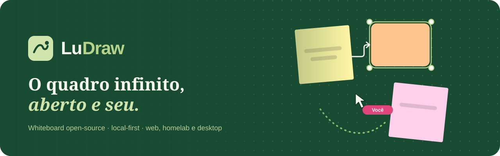
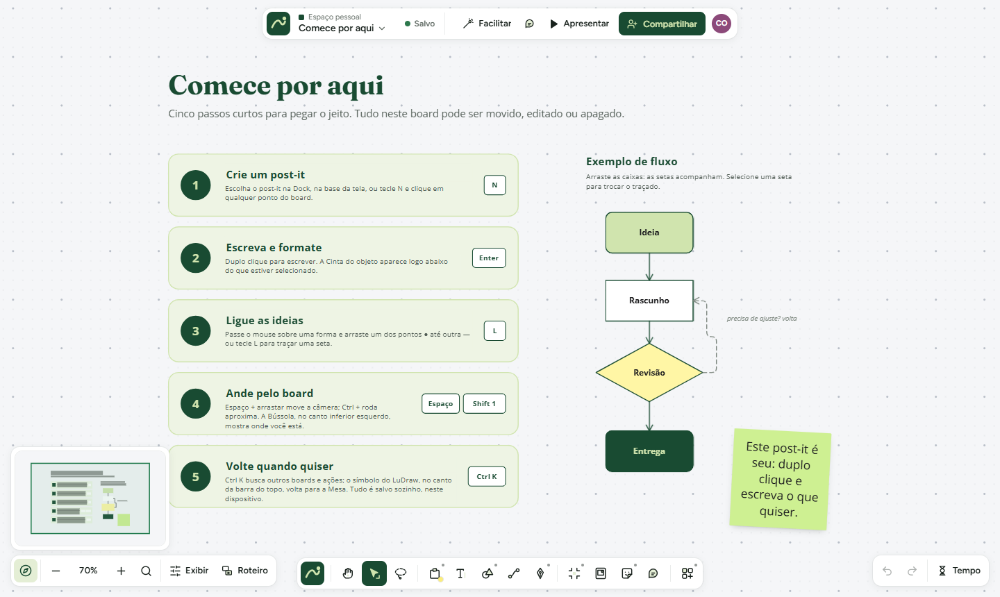
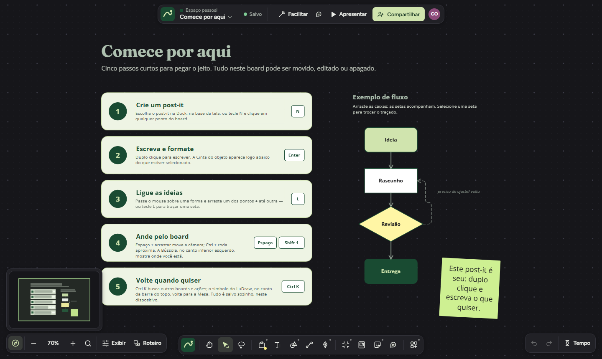

<div align="center">



<br />
<br />

**Um quadro branco infinito para pensar, desenhar e planejar, sozinho ou em equipe.**<br />
Funciona direto no navegador, guarda os dados com você e pode ser hospedado no seu próprio servidor.

<br />

**Português (Brasil)** · [English](README.en.md)

<br />


[Sobre](#-sobre-o-projeto) · [O que faz](#-o-que-o-ludraw-faz) · [Limites](#-o-que-ele-não-faz-ou-faz-com-ressalvas) · [Como começar](#-como-começar) · [Contribuindo](#-contribuindo)

</div>

---

## 🌱 Sobre o projeto

O LuDraw é um projeto de **Luka Piancó** ([LUKA.DEV](https://github.com/lukapianco)) e nasceu como um **projeto de estudo**: eu queria aprender a construir um programa completo, do canvas à colaboração em tempo real, com todas as funções que uma pessoa precisa para usá-lo no dia a dia. No caminho aprendi muita coisa nova (renderização em canvas, edição simultânea, permissões, segurança, acessibilidade, internacionalização) e descobri jeitos mais rápidos de trabalhar.

Ele não tenta ser nada além do que entrega: um quadro branco infinito, bonito e utilizável, que você pode abrir agora mesmo ou instalar para a sua equipe.

> **Sobre manutenção:** como é um projeto de estudo, não prometo atualizações contínuas. Se alguém quiser **usar**, **sugerir** ou **desenvolver novas funções**, fico muito feliz: veja [Contribuindo](#-contribuindo).

---

## 🖼️ Veja como é

<div align="center">



<sub>Tema claro: o board de boas-vindas, com a barra do topo, a Dock de ferramentas e o minimapa.</sub>

<br />
<br />



<sub>Tema escuro: o mesmo board.</sub>

</div>

---

## ✨ O que o LuDraw faz

São mais de **140 funções catalogadas** em [`docs/FEATURES.md`](docs/FEATURES.md), cada uma com o lugar onde encontrá-la e o atalho. Em resumo:

<table>
<tr>
<td width="50%" valign="top">

### 🧭 Canvas infinito
- Mover com **Espaço + arrastar**, botão do meio ou ferramenta Mão
- **Zoom** suave focado no cursor (2% a 400%)
- Grade de **pontos ou linhas**, cor de fundo, **minimapa**
- Seleção por retângulo, laço e Shift + clique
- **Guias inteligentes** e ajuste à grade

### ✍️ Objetos
- **Post-its** com ajuste automático de fonte
- **11 formas** (retângulo, oval, losango, estrela, nuvem, cilindro…)
- **Textos** com 20 fontes, listas, links e marca-texto
- **Caneta, marca-texto e borracha**
- Imagens e **frames**

</td>
<td width="50%" valign="top">

### 🔗 Conectores
- Pontos de conexão com prévia; um clique cria um objeto já ligado
- Linhas **retas, em cotovelo ou curvas**, cinco tipos de ponta
- Percurso editável ou **ajuste automático** que desvia dos objetos
- Rótulos, inserir forma no meio da linha

### 🛠️ Edição
- Seleção múltipla, alças de tamanho e rotação
- **Desfazer/refazer**, histórico de versões
- Agrupar, camadas, alinhar e distribuir
- Copiar e colar estilo, duplicar com **Alt + arrastar**, bloquear

</td>
</tr>
<tr>
<td valign="top">

### 🧩 Ferramentas de trabalho em grupo
- **Kanban**, **tabelas** (com células mescladas), **mapa mental**
- **Diagrama por texto**: escreva e o diagrama aparece
- **Modo apresentação** a partir dos frames
- **Votação por pontos**, **timer**, comentários e reações
- **Galeria de templates** e templates próprios

### 👥 Colaboração (com servidor)
- **Edição ao vivo** com várias pessoas, cursores e presença
- Seguir a tela de alguém
- Permissões no board: dono, editor, comentarista e leitor, além de convidados e links públicos

</td>
<td valign="top">

### 📤 Exportar e 📥 importar
- **PNG** (1x, 2x e 4x), **SVG vetorial**, **PDF** de página única ou **multipáginas por frames**
- **CSV** e **copiar como planilha**, com proteção contra injeção de fórmulas
- Importar **planilhas** (`.xlsx`, `.ods`, `.csv`, `.tsv`), **SVG editável**, arquivos `.excalidraw`, imagens e texto, colando, arrastando ou pelo menu
- **Backup `.ludraw`** e restauração
- Código **`<iframe>`** para incorporar um board

</td>
<td valign="top">

### 🗂️ Espaço de trabalho e administração
- Mesa com recentes, favoritos, busca, espaços, times e pastas
- **Contas e login da empresa** (OIDC genérico), convites por link ou e-mail
- Administração: membros, times, políticas, convidados, **lixeira**, backup e **Audit Log**
- **Extensões** com permissões explícitas, executadas isoladas do restante do app

</td>
</tr>
</table>

**Outros pontos:** tema claro e escuro, **acessibilidade** (foco visível, contraste conferido por teste e navegação por teclado), **português do Brasil e inglês**, e um **Design System** documentado.

---

## 🧭 Três jeitos de usar

| | **Navegador** | **Programa desktop** | **Servidor com Docker** |
|---|---|---|---|
| Para quem | Testar ou uso pessoal | Uso pessoal sem navegador, ou como cliente do servidor da equipe | Equipes e organizações |
| Onde ficam os dados | No navegador, neste dispositivo | Na pasta do programa, neste computador | No PostgreSQL do seu servidor |
| Conta | Não precisa | Não precisa (Modo Local) | E-mail e senha ou login da empresa |
| Colaboração ao vivo | Não | Só conectado a um servidor | Sim |
| Backup | Manual (arquivo `.ludraw`) | Manual (arquivo `.ludraw`) | Banco de dados + pasta de imagens |

**Modo Local** é o uso sem servidor (navegador ou desktop); **Modo Servidor** é quando há um servidor LuDraw. No navegador, o app descobre sozinho se existe um servidor na mesma origem e escolhe o modo; no desktop, você escolhe na primeira abertura.

---

## 🚀 Como começar

Não existe um site oficial hospedado: você roda o LuDraw no seu computador ou no seu servidor. Escolha um dos três caminhos.

### 1️⃣ No navegador (Modo Local, sem conta)

**Precisa de:** [Node.js](https://nodejs.org) 22.6+ (versão em `.nvmrc`) e [Git](https://git-scm.com).

```bash
git clone https://github.com/lukapianco/ludraw.git
cd ludraw
npm install
npm run dev
```

Abra **http://localhost:5173**, clique em **“Continuar sem conta”** e explore o board de boas-vindas. Para uma versão mais leve, que não recarrega sozinha: `npm run build` e depois `npm run preview`.

Os boards ficam no armazenamento do navegador. Para guardar uma cópia, use **Ficha do board → Exportar → Fazer backup do board** (arquivo `.ludraw`).

### 2️⃣ Programa desktop (Windows e Linux)

O programa pergunta, na primeira vez, onde você quer trabalhar: **neste computador** (Modo Local) ou no **servidor da sua organização**. A escolha fica guardada e pode ser trocada em **LuDraw → Trocar onde trabalhar…**

#### Opção A: baixar o instalador

Os instaladores serão publicados nos *Releases* do GitHub a partir da primeira versão lançada, junto de um arquivo **`SHA256SUMS`**.

| | Windows 10/11 (64 bits) | Linux (Debian 12+, Ubuntu 22.04+) |
|---|---|---|
| Arquivo | `LuDraw_<versão>_x64-setup.exe` | `ludraw_<versão>_amd64.deb` |
| Instalar | Abra o instalador (só para o seu usuário, sem administrador) | `sudo apt install ./ludraw_<versão>_amd64.deb` |
| Boards do Modo Local | `%LOCALAPPDATA%\app.ludraw` | `~/.local/share/app.ludraw` |
| Desinstalar | Configurações → Aplicativos → LuDraw | `sudo apt remove ludraw` |

Desinstalar **não apaga os boards**. No Windows, o desinstalador só apaga se você marcar a opção para isso; no Linux, a pasta continua lá.

**Confira o arquivo antes de instalar** e compare o resultado com a linha dele no `SHA256SUMS`:

```bash
# Linux (na pasta onde baixou os arquivos)
sha256sum -c SHA256SUMS --ignore-missing
```

```powershell
# Windows (PowerShell)
Get-FileHash .\LuDraw_<versão>_x64-setup.exe -Algorithm SHA256
```

> ⚠️ **O instalador do Windows não tem assinatura digital.** Por isso o Windows pode avisar que o editor é desconhecido (SmartScreen) e, em computadores com o **Controle Inteligente de Aplicativos** ligado, pode bloquear o instalador. Se o SHA-256 não bater, **não instale**. Não desligue nenhuma proteção do Windows para instalar o LuDraw: se ele for bloqueado, use o LuDraw pelo navegador ou por um servidor da sua organização.

#### Opção B: compilar você mesmo

Serve enquanto não houver versão publicada, ou se você prefere gerar o instalador a partir do código.

**Precisa de:**
- Node.js 22.6+ e Git.
- **Rust**, pelo [rustup](https://rustup.rs). A versão exata fica em `src-tauri/rust-toolchain.toml` e o rustup a instala sozinho.
- **Windows:** as *Ferramentas de Build do Visual Studio* com a carga **“Desenvolvimento para desktop com C++”**. O WebView2 já vem no Windows 11; no Windows 10, o instalador baixa se faltar.
- **Linux:** `sudo apt install build-essential libwebkit2gtk-4.1-dev`. Se o build reclamar de outra biblioteca, a mensagem do `cargo` diz qual.

```bash
git clone https://github.com/lukapianco/ludraw.git
cd ludraw
npm install
npm run desktop:dev        # compila e abre o programa (a 1ª vez demora)
npm run desktop:package    # gera o instalador do seu sistema
```

O instalador sai em `src-tauri/target/release/bundle/`: um `.exe` (NSIS) em `nsis/` no Windows, ou um `.deb` em `deb/` no Linux. Instale como na tabela acima.

> 💡 O `desktop:dev` usa o **perfil real** do programa (a mesma pasta de boards da tabela). Os boards que você criar ali ficam salvos.

**Limites do programa desktop:**
- Os boards do desktop e os do navegador são **separados**; para levar de um ao outro, use o backup `.ludraw`.
- No Modo Servidor, o servidor precisa estar no ar para o programa abrir (o app vem dele).
- Servidor com certificado próprio exige que o certificado seja confiável no sistema.
- Login da empresa (SSO) funciona quando o provedor redireciona direto para o endereço dele; federação para outro domínio não entra pelo desktop.

### 3️⃣ Servidor com Docker (equipes, homelab)

Para boards compartilhados, contas, convites e colaboração ao vivo. Sobe o LuDraw e um PostgreSQL, na mesma origem.

**Precisa de:** Docker Engine 24+ com Compose v2.24+ (ou Docker Desktop no Windows/macOS) e Node.js 22+ na máquina, só para os scripts de segredos e de backup. Para uso na rede, um proxy reverso com HTTPS (Caddy, Traefik, nginx…).

> A imagem ainda **não está publicada** num registro (isso está em preparação). Por enquanto o Compose a **constrói a partir do código**, o que leva alguns minutos na primeira vez.

```bash
git clone https://github.com/lukapianco/ludraw.git
cd ludraw
node scripts/docker-secrets.mjs                     # 1) segredos aleatórios em deploy/secrets/ (uma vez)
cp deploy/ludraw.env.example deploy/ludraw.env      # 2) opcional: endereço público, e-mail, SSO…
docker compose up -d --build                        # 3) constrói a imagem e sobe banco → migração → app
docker compose logs app                             # 4) copie o token do primeiro acesso
```

Abra **http://localhost:8080**. O assistente **Primeiro acesso do servidor** pede o token (ele aparece **uma vez** no log), o nome da organização e a primeira conta de administrador. Para gerar outro token: `docker compose exec app ludraw setup:token`.

**Depois de instalar:**
- **Pela rede:** ponha um proxy com HTTPS na frente e defina `LUDRAW_PUBLIC_URL` e `LUDRAW_TRUST_PROXY` em `deploy/ludraw.env`. Exemplos de Caddy e nginx em [docs/DOCKER.md](docs/DOCKER.md#proxy-reverso-e-https).
- **Backup:** `node scripts/docker-backup.mjs backup` guarda o banco e as imagens ([docs/BACKUP.md](docs/BACKUP.md)).
- **Pelo desktop:** no programa, escolha **servidor** e informe o endereço.
- **Mais opções** (e-mail, login da empresa, várias instâncias com Valkey): [docs/DOCKER.md](docs/DOCKER.md) e [docs/SERVIDOR.md](docs/SERVIDOR.md).

---

## 🧱 O que ele não faz (ou faz com ressalvas)

Para você decidir com clareza se o LuDraw serve para o que precisa:

- **Não é um serviço hospedado.** Não existe um site oficial onde criar conta: você abre localmente ou hospeda o seu.
- **Modo Local não sincroniza.** Os boards ficam no navegador em que foram criados; para levar a outro lugar, use o backup `.ludraw`.
- **Uma organização por instalação.** O modo com várias organizações no mesmo servidor ainda não está disponível.
- **Tempo real em uma única instância do servidor.** Rodar várias cópias do servidor lado a lado ainda não é suportado para a edição ao vivo.
- **Sem aplicativo de celular.** A interface é pensada para computador e navegadores modernos. Há o programa desktop para Windows e Linux (veja acima).
- **Extensões testadas em Chrome e Edge.** O isolamento das extensões ainda precisa ser verificado em Firefox e Safari.
- **Alguns itens aparecem como "Em breve"** (por exemplo, cronograma, gravação em vídeo e protótipo navegável) e ainda não funcionam. As notificações também ainda não existem.
- **Idiomas:** português do Brasil e inglês. Outros idiomas entram com um arquivo JSON (veja [docs/TRANSLATING.md](docs/TRANSLATING.md)).
- **Não é um editor de ilustração, de CAD nem de vídeo.** É um quadro para ideias, fluxos e planejamento.
- **Projeto de estudo, versão `0.x`:** pode haver arestas, e não há garantia de suporte contínuo.

---

## 🛠️ Para desenvolver

O passo a passo para rodar está em [Como começar](#-como-começar). Estes são os comandos do dia a dia:

| Comando | O que faz |
|---|---|
| `npm run dev` | Servidor de desenvolvimento com recarga automática |
| `npm run build` | Build de produção em `dist/` |
| `npm run preview` | Serve o build localmente |
| `npm run typecheck` | Verificação de tipos (TypeScript strict) |
| `npm run server:dev` | API do Modo Servidor em desenvolvimento (porta 3001) |
| `npm run test:server` | Testes do servidor, sem Docker |
| `npm run desktop:dev` | Compila e abre o programa desktop |
| `npm run test:desktop` | Testes do programa desktop (configuração, permissões e CSP) |

A lista completa de comandos de teste e verificação está no **[CONTRIBUTING.md](CONTRIBUTING.md)**.

> 💡 **Onde ficam meus dados?** No navegador ou no desktop (Modo Local), no armazenamento do próprio programa. Use **Ficha do board → Exportar → Fazer backup do board** para guardar um arquivo `.ludraw`. No Modo Servidor, no PostgreSQL do servidor.

## ⌨️ Atalhos principais

| Ação | Atalho | | Ação | Atalho |
|---|---|---|---|---|
| Selecionar / Mão | `V` / `H` | | Desfazer / Refazer | `Ctrl Z` / `Ctrl Y` |
| Post-it / Texto | `N` / `T` | | Duplicar | `Ctrl D` |
| Retângulo / Oval | `R` / `O` | | Agrupar | `Ctrl G` |
| Linha com seta | `L` | | Encontrar | `Ctrl F` |
| Caneta / Borracha | `P` / `E` | | Ajustar à tela | `Shift 1` |

Dentro de um board, pressione `?` para ver a lista completa.

---

## 🔐 Segurança e privacidade

- Senhas com **argon2id**; tokens e links guardados só como hash.
- Permissões aplicadas **no servidor**, com as mesmas regras do app.
- O projeto passou por **auditorias internas** de origem do código, acessibilidade e segurança, com os achados e correções registrados. **Não houve auditoria externa independente.**
- O Audit Log guarda o IP de ações sensíveis por um prazo configurável (padrão 90 dias) e depois o apaga.
- Para relatar uma falha de segurança, veja o **[SECURITY.md](SECURITY.md)**.

---

## 🌍 Idiomas

A interface vem em **português do Brasil** e **inglês**. Por padrão segue o navegador; em **Configurações → Perfil → Idioma e região** você escolhe outro, sem recarregar. O conteúdo dos seus boards nunca é traduzido.

- Idiomas e completude: **[docs/LANGUAGES.md](docs/LANGUAGES.md)**
- Como criar um idioma novo só com JSON: **[docs/TRANSLATING.md](docs/TRANSLATING.md)**

---

## 🧱 Como é feito

- **App:** React 18, TypeScript (strict), Vite, Tailwind e Zustand.
- **Servidor:** Node.js, Fastify, Drizzle e PostgreSQL.
- **Tempo real:** Yjs e Hocuspocus.
- **Princípios:** toda a geometria passa por `screenToWorld`/`worldToScreen`; uma só geometria desenha a tela e a exportação; nenhum texto fixo na interface (tudo por `t()`); as regras de permissão e de espaço de trabalho são as mesmas no app e no servidor.
- **Visual:** paleta verde-floresta `#194B32` e verde-pistache `#D0E4AE`, tipografia Figtree + Fraunces. Documentação em [`docs/DESIGN_SYSTEM.md`](docs/DESIGN_SYSTEM.md).

Pastas principais: `src/` (app), `server/` (API e banco), `docs/` (documentação pública) e `scripts/` (verificações).

---

## 🗺️ Estado do projeto

**Pronto:** canvas e objetos, conectores, widgets de trabalho em grupo, importação e exportação, internacionalização, persistência local, servidor com contas e permissões, edição ao vivo, e-mail e acesso, imagem Docker para hospedar em casa ou na empresa, programa desktop (Windows e Linux) e auditorias internas de origem do código, design/acessibilidade e segurança.

**Em preparação:** distribuição pronta para homelab: imagem publicada no `ghcr.io` e modelos para TrueNAS, Unraid, CasaOS, Umbrel, Runtipi, Cosmos, Dockge e Portainer.

**Sem compromisso de data:** tudo o que não está acima. Veja as ideias e pendências em [CONTRIBUTING.md](CONTRIBUTING.md) e nas *issues*.

---

## 🤝 Contribuindo

Contribuições são muito bem-vindas, de código, tradução, documentação, testes ou ideias.

Leia o **[CONTRIBUTING.md](CONTRIBUTING.md)** antes de começar: ele traz o passo a passo, as verificações e as **regras de origem do código**, que valem para toda contribuição (todo código, texto e imagem precisa ter origem própria ou licença compatível).

1. Faça um fork e crie uma branch: `git checkout -b feat/minha-ideia`
2. Antes do PR, rode as verificações listadas no CONTRIBUTING
3. Para interface, use os tokens do Design System; texto novo entra nos catálogos `pt-BR` **e** `en`
4. Preencha o modelo de pull request

Encontrou um bug ou tem uma ideia? Abra uma *issue* pelos modelos. Histórico de versões: **[CHANGELOG.md](CHANGELOG.md)**.

---

## 📄 Licença e créditos

Distribuído sob a licença [MIT](LICENSE).

O LuDraw usa bibliotecas de código aberto, listadas com suas licenças em [`THIRD_PARTY_NOTICES.txt`](THIRD_PARTY_NOTICES.txt) (app) e [`server/THIRD_PARTY_NOTICES.txt`](server/THIRD_PARTY_NOTICES.txt) (servidor). A origem de dependências, ícones e formatos está registrada em [`docs/PROVENANCE.md`](docs/PROVENANCE.md).

<div align="center">

<br />

Feito com 💚 e muitos post-its.

</div>
